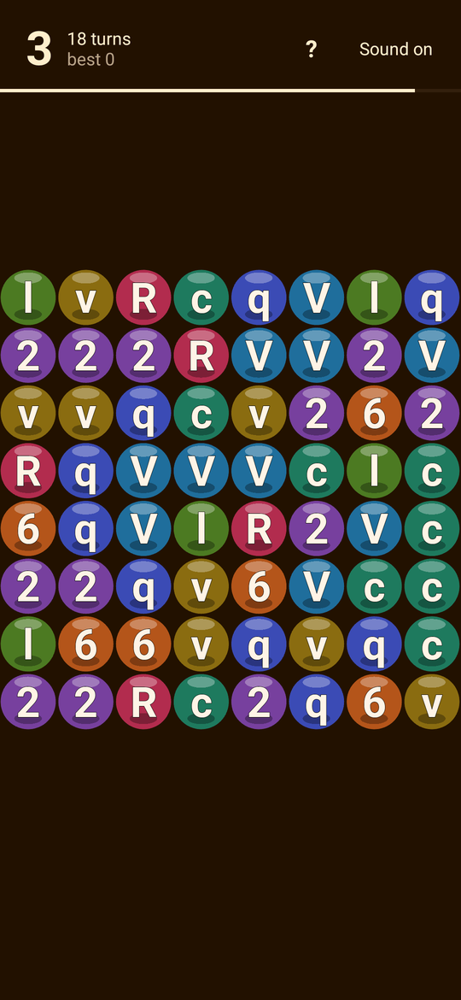

# Text Crush — Android

The word-board game from [textcrush](https://github.com/kevinelong/textcrush), packaged as a
full-screen, offline Android app. Tap a letter to clear the run of matching letters it belongs to;
everything above falls down and new letters drop in from the top. Twenty turns, and the points grow
exponentially with the size of the run you clear, so one big group beats five small ones.



## Install

1. On your phone, open **[Releases](https://github.com/kevinelong/textcrush-android/releases/latest)**
   and download `textcrush-release.apk`.
2. Tap the downloaded file. Android will ask you to allow installing apps from this source - that is
   the standard prompt for any app that does not come from Play.
3. Launch **Text Crush**. It is a 206 KB download that never asks for a permission and never goes
   online.

| Artifact | Size | SHA-256 | Purpose |
| --- | --- | --- | --- |
| `textcrush-release.apk` | 206,173 bytes | `1c269a2b4afa2193d53b859f4bdc36aba6d2b7945a602d1404293a2520985875` | release-signed, for the phone — this is the published file |
| `out/textcrush.apk` | 202,077 bytes | `a4040eb3ce521e40a5c04577285945f9687c25a3fcf60b1f94e538fdbb98e223` | debug-signed, for the dev loop (`sh build.sh`) |

Requires Android 5.0 (API 21) or newer. Portrait, full screen, screen stays awake while you play.

## How it plays

- **The board** is 8x8, drawn from 8 distinct letters and digits per game.
- **Tap a tile** to clear it together with every tile connected to it (up, down, left, right) that
  carries the same character.
- **Scoring** is `2^(n-1)` for a run of `n`: a single tile is 1 point, two is 2, three is 4, eight is
  128. A turn is spent whatever the size, so the game is about hunting large groups.
- **Then the board settles**: cleared tiles fall, and the gap at the top of each column is refilled
  from above. The animation is the fall, not a jump — a tile that falls further simply takes a
  little longer.
- After **20 turns** the game ends and the high score is kept **on the device** (in the app's own
  storage). Nothing is uploaded anywhere, because the app has no network permission.

## What it does and does not do

- **No permissions at all.** Not even `INTERNET`. The game is bundled inside the APK and is served
  to the WebView from those same assets, so the app cannot reach the network even by accident.
- **No ads, no analytics, no trackers, no third-party libraries** — the build has no dependencies
  beyond the Android framework itself.
- **The only thing stored** is your high score, in the app's private storage, on your phone.

## Build

No Gradle, no Android Studio, no AndroidX. The APK is assembled from the SDK tools directly, which
keeps the build fast, offline after the first bootstrap, and easy to read end to end.

```sh
sh tools/bootstrap.sh        # one-off: portable JDK 17 + cmdline-tools + platform-34 + build-tools
sh build.sh                  # -> out/textcrush.apk          (debug-signed, ~4 s)
SIGN=release sh build.sh     # -> out/textcrush-release.apk  (needs tools/make-release-key.sh once)
sh tools/verify-ui.sh        # install on a running emulator/device and play the game
```

Pipeline: stage the web build into assets -> `aapt2 compile` -> `aapt2 link` ->
`javac` (source/target 8 against `android.jar`) -> `d8` -> splice `classes.dex` into the resource APK
-> `zipalign` -> `apksigner`. The TypeScript sources in `game/` are not shipped; only the JavaScript,
source maps and HTML the page loads at runtime reach the APK.

```sh
sh tools/make-avd.sh         # create the throwaway verification AVD (Android 14, pixel_5)
sh tools/run-emulator.sh     # boot it headless; add "window" to watch it on the desktop
```

The `toolchain/` directory is git-ignored. `tools/bootstrap.sh` builds it; if you already have a
toolchain from another project, link it in instead (`mklink /J toolchain <other>\toolchain`).

**Keep `tools/release.keystore` and `tools/release-credentials.txt`.** They are git-ignored, they are
the app's permanent signing identity, and losing them means never being able to update an installed
copy of the app. Copy both somewhere off this machine.

## Verification

The published APK was installed on an Android 14 (pixel_5) emulator and played. Measured, not just
looked at:

- **It runs and paints**: the board, score line and turn counter render, and a tap changes the score
  line and the board (`tools/verify-ui.sh` reports the sampled pixel counts and the image diff).
- **No crash**, and `dumpsys package com.kevin.textcrush` lists **no requested permissions**.
- **Taps outside the board do nothing.** The square the game draws in is nine rows tall and the score
  line keeps the top one, so a tap there is a tap on the game. It used to index past the board
  (`positions[y*size + x]` with a negative index), throw, and - because the board had already been
  marked busy - leave the game frozen for good. `tools/verify-ui.sh` now taps that line three times
  and checks the score line is byte-identical afterwards and still responds to a real tap.
- **The animations were stepped frame by frame inside the app's own WebView** (WebView devtools over
  `adb forward tcp:9222 localabstract:webview_devtools_remote_<pid>`): the deal-in drew 2,583
  sampled pixels blank, 47,103 mid-way and 94,717 when settled, and a fall showed all 64 cells placed
  on fractional rows mid-flight before the final static frame. On game over the 48-particle burst
  grew from scale 0.98 to 1.89 while fading from opacity 0.61 to 0.01, drawn by the compositor.
- **The high score survives a restart**: a score was reached, the app was force-stopped and cold
  started, and the same value was read back from `localStorage` at the app's own origin
  (`https://appassets.textcrush.local`). That origin is why the app hosts the page from its assets
  rather than opening it as a `file://` document — a `file://` page has no durable storage, and a
  randomly chosen loopback port would have moved the origin on every launch and silently reset it.
- **The board is drawn at the screen's density and the palette is deliberate.** The canvas carries
  one backing pixel per device pixel (1081x1081 on this 440 dpi screen) instead of being rasterised at
  393 px and stretched 2.75x, and the eight tile colours are a fixed set rather than eight random picks
  from a 26,640-entry lattice: measured, the closest pair on a board is dE 20.5 where 93% of boards
  used to hold a pair closer than dE 20, and the warm-white letter clears 4.5:1 on every tile where 57%
  of letters used to sit below 3:1.
- **The score line is native Android text now**: the game is loaded with `hud=off` and keeps no room for
  its own score line, so the header shows the score, turns left, best and the sound button as real
  views - crisp at the screen's density, scalable with the system font setting, and readable by a
  screen reader. The page reports its state to the app through a small bridge, and the board takes the
  whole square: measured `scoreHeight` 0, tile step 55 -> 61 px, board 491 px across the canvas. A tap
  in the header cannot reach the game at all; a board tap moves both the board and the header (the
  script checks both).
- **The board is reachable without seeing it.** The canvas has a clipped DOM mirror of the 64 cells
  with their letters and positions, plus a live region for the score, and Enter plays a cell through
  the same pipeline as a tap - measured from "Score 0, 20 turns left" to "Score 4, 19 turns left".
  `uiautomator` sees the cells and the header's text.
- **The landing squash follows the tiles that moved**: only tiles that fell squashed, by how far they
  fell (a one-bubble tap nudges the few tiles above it; a column collapse thuds). It used to squash all
  64 tiles at once, which read as the whole board bouncing on any tap. The system's motion preference is
  honoured too (no deal-in, no fall, no pop, no
  float when reduced motion is on: 6,412 painted samples at 80 ms normally against 36,798 with it
  reduced).
- **The tap answers**: a pressed tile is drawn pressed before the run clears, the run shrinks away
  over 110 ms instead of blinking out, and what it scored ("+16") rises from where it stood. A tap
  also asks the app for a short haptic tick through a small JavaScript bridge - measured on the AVD:
  three taps on the board added two recorded vibrations.
- **The score line is legible and safe**: cream ink on a dark outline (15.98:1) instead of #333333
  fill on a #ffeecc outline (1.45:1), and tiles are clipped to the board so a refill can no longer
  paint over it. Measured: the saturated pixel count inside the HUD band is identical settled and
  mid-deal-in, and the dominant ink pixel is 255,238,204.
- **The game-over card is stacked, not clipped**: recorded text calls land at "Game Over" y=195,
  "Previous High Score:" y=245, the score y=296 and "Tap to Continue" y=436, all inside the canvas,
  where a single 40-character line used to run off both edges.
- **Audio works without a tap first**: a fresh `AudioContext` reports `running`, i.e. the WebView is
  allowed to play the game's notes (`setMediaPlaybackRequiresUserGesture(false)`).

## Known limitations

- **The play area is a centred square.** The game lays itself out from the smaller viewport
  dimension, so the wrapper gives it a square of the display width and centres it rather than
  leaving the board pinned to the top of a tall phone. A phone screen is much taller than it is
  wide, so there is background above and below — the game itself draws into that square.
- **The rendering is slightly soft on high-density screens.** The game sizes its canvas in CSS
  pixels rather than device pixels, so a 3x screen gets a 1x canvas scaled up. Fixing it is a small
  change in the game repository (canvas backing store times `devicePixelRatio`, and the same factor
  on the tap coordinates).
- **The game-over message can run off the edges.** `Display.middleCenterText` draws the whole
  message — which contains newlines — as a single line, so on a narrow screen it is clipped. That is
  the upstream game's own text rendering, unchanged here; the fix belongs in the game repository.
- **Portrait only.** Rotating would re-lay-out a canvas that the game sizes only at load, so the
  activity is locked to portrait.

## Upstream and license

The game itself lives in [kevinelong/textcrush](https://github.com/kevinelong/textcrush); `game/` here
is that source at commit `8ad1caf`, vendored so the APK build has no external checkout. Everything
under `game/` is upstream's; the Android wrapper is this repository.

Licensed under the **Functional Source License, Version 1.1, MIT Future License** (`FSL-1.1-MIT`) —
see [LICENSE.md](LICENSE.md). In short: use, copy, modify and redistribute it freely, including
commercially, except to build a competing product or service; two years after each release the
license converts to plain MIT.
